<div align="center">



<br>

[](https://unwind-brand-guard.vercel.app/)
[](https://react.dev/)
[](https://expressjs.com/)
[](https://supabase.com/)
[](https://aistudio.google.com/)

**[Live demo](https://unwind-brand-guard.vercel.app/)** &nbsp;|&nbsp; **[Features](#-features)** &nbsp;|&nbsp; **[How it works](#-how-it-works)** &nbsp;|&nbsp; **[Architecture](#-architecture)** &nbsp;|&nbsp; **[Getting started](#-getting-started)** &nbsp;|&nbsp; **[Roadmap](#-roadmap)**

</div>

<div align="center">

<sub>**AI advises. People decide.** &nbsp;·&nbsp; Text, image and PDF review &nbsp;·&nbsp; Explainable findings &nbsp;·&nbsp; Workspace-level security</sub>

</div>


## 📖 Table of contents

- [Why BrandGuard?](#-why-brandguard)
- [Features](#-features)
- [How it works](#-how-it-works)
- [Review workflow](#-review-workflow)
- [Compliance analytics](#-compliance-analytics)
- [Tech stack](#-tech-stack)
- [Architecture](#-architecture)
- [Project structure](#-project-structure)
- [Getting started](#-getting-started)
- [Environment variables](#-environment-variables)
- [Database and security](#-database-and-security)
- [Deployment](#-deployment)
- [Uptime monitoring](#-uptime-monitoring)
- [Troubleshooting](#-troubleshooting)
- [What's shipped](#-whats-shipped)
- [Roadmap](#-roadmap)
- [Contributing](#-contributing)
- [License](#-license)


## 💡 Why BrandGuard?

Brand consistency breaks down quietly. Different teams, channels, and writers interpret the same guidelines differently, and PDF style guides are rarely open at the moment content is written.

**Unwind BrandGuard turns your brand guidelines into something that actively checks content.** Teams define their rules once, submit content for analysis, and get clear, explainable feedback: what is wrong, which guideline it breaks, and how to fix it. AI does the first pass. **People make the final call.**

| The problem | How BrandGuard helps |
|---|---|
| Guidelines live in static documents nobody checks | Guidelines become the live basis for AI evaluation |
| Reviews are slow and subjective | Instant, consistent first-pass analysis |
| Feedback says *what* but not *why* | Every finding links to the guideline it relates to |
| Review history gets lost in chat threads | Persistent review records and version history per workspace |
| Visual content slips through text-only checks | Images and PDFs are reviewed against the same guidelines |
| Onboarding reviewers is messy | Email invitations with role-based access |

<br>

<div align="center">

<sub>Illustration of a review. Every finding carries its evidence, the guideline it relates to, a severity, and a suggested fix.</sub>
</div>


## ✨ Features

<div align="center">

</div>

<br>

### 🔐 Authentication and workspaces
- Secure sign-up and login with **Supabase Auth**, with protected workspace access
- Create, rename, and manage workspaces with custom names
- Data is isolated per workspace and membership is checked on every request
- Role-based access control, with owner-level permissions protected

### 📚 Brand guidelines management
- Create and maintain workspace-specific brand guidelines
- Define rules for identity, tone of voice, messaging, terminology, and communication standards
- Guidelines act as the source of truth for every AI analysis

### 🤖 AI-powered content analysis
Powered by the **Google Gemini API**, each analysis checks content against your workspace's guidelines for:

- **Brand voice and tone**
- **Terminology consistency**
- **Unsupported promotional claims**
- **Approved-fact verification**
- **Accessibility concerns**

Each finding comes with a plain-language explanation, the guideline it relates to, and an actionable correction.

### 🖼️ Multimodal content review
Review more than text. BrandGuard analyzes visual and document-based content against the same approved guidelines.

- **Image analysis:** PNG, JPG, JPEG, and WEBP uploads, to catch visual brand inconsistencies, terminology issues, and accessibility concerns
- **PDF analysis:** submit PDF documents for content and visual compliance checks
- **Combined analysis:** submit text together with an image or PDF for one comprehensive review
- **Evidence-based findings:** every issue shows supporting evidence, a guideline reference, a severity level, and a recommended correction
- **Secure asset handling:** authenticated uploads, workspace-based access controls, private Supabase Storage, and signed URLs for viewing assets
- **Unified workflow:** multimodal results land in the same review history for human evaluation and approval

### ✅ Content review and approval
- Complete content submission workflow with review status management
- Reviewer and manager involvement, with approve, reject, and request-changes actions
- Collaborative review with **content version history**
- Human-controlled approvals: AI advises, people decide

### 📊 Compliance analytics
- Dashboard of brand governance insights and review results
- Compliance performance tracking over time
- Visibility into recurring guideline violations

### 👥 Team collaboration
- Invite members by email, delivered through **Brevo**
- Secure invitation flow: hashed tokens, automatic acceptance after authentication, and profile-name collection when needed
- Invited users land directly in the workspace they were invited to
- Members show real names (from Supabase Auth metadata) with email, joining date, and initials avatars

### 🔒 Security by design
- **PostgreSQL** via Supabase with **Row Level Security (RLS)**
- Privileged operations run only on the backend with admin credentials
- Rate limiting and content-length validation on analysis requests
- Secrets live in environment variables, never in frontend code


## 🔄 How it works

<div align="center">

</div>

1. **Sign in** through the React frontend. Supabase Auth manages sessions.
2. **Create a workspace** and define its brand guidelines.
3. **Submit content** as text, an image, a PDF, or a combination. The request goes through the Express backend.
4. The backend sends the content and the workspace's guidelines to **Google Gemini**.
5. **Findings come back** with violations, evidence, severity, linked guidelines, and suggested fixes.
6. **Review data is stored** in Supabase PostgreSQL, and uploaded assets in private Supabase Storage.
7. **Teammates review** and approve, reject, or request changes. Every revision is kept in version history.
8. **RLS policies** enforce workspace-level data access throughout.


## 🧭 Review workflow

<div align="center">

</div>

AI findings never publish anything on their own. Content moves forward only when a person approves it, and a requested change creates a new version so the full history stays traceable.


## 📊 Compliance analytics

<div align="center">

<sub>Illustration with sample numbers. The dashboard highlights score trends and which guidelines are broken most often.</sub>
</div>


## 🧰 Tech stack

<div align="center">

</div>

<br>

| Layer | Technology |
|---|---|
| **Frontend** | React 19, Vite, JavaScript, CSS |
| **Backend** | Node.js, Express.js (REST API) |
| **Database** | Supabase PostgreSQL with Row Level Security |
| **Storage** | Private Supabase Storage with signed URLs |
| **Auth** | Supabase Auth |
| **AI** | Google Gemini API (text, image, and PDF analysis) |
| **Email** | Brevo (transactional invitations) |
| **Hosting** | Vercel (frontend), Render (backend) |
| **Monitoring** | UptimeRobot |
| **Tooling** | Git and GitHub |


## 🏗️ Architecture

<div align="center">

</div>

For a deeper walkthrough, see [`PROJECT_ARCHITECTURE.md`](PROJECT_ARCHITECTURE.md).


## 📁 Project structure

```text
Unwind-BrandGuard/
├── frontend/                  # React 19 + Vite app
│   ├── src/
│   │   ├── components/        # Reusable UI components
│   │   ├── pages/             # Route-level pages
│   │   ├── supabase.js        # Supabase client setup
│   │   ├── App.jsx
│   │   └── App.css
│   ├── public/
│   └── package.json
│
├── backend/                   # Express REST API
│   ├── src/
│   │   ├── config/
│   │   │   └── supabaseAdmin.js   # Privileged Supabase client
│   │   ├── routes/                # API route definitions
│   │   ├── controllers/           # Request handlers
│   │   ├── middleware/            # Auth, validation, rate limiting
│   │   └── server.js              # Entry point
│   └── package.json
│
├── supabase/                  # Database schema, policies, functions
├── PROJECT_ARCHITECTURE.md
├── LICENSE.md
└── README.md
```

> This is a representative structure; the repository may contain additional files.


## ⚙️ Getting started

### Prerequisites

| Requirement | Notes |
|---|---|
| [Node.js](https://nodejs.org/) | Current LTS recommended |
| npm | Ships with Node.js |
| [Git](https://git-scm.com/) | |
| [Supabase](https://supabase.com/) project | Provides Auth, PostgreSQL, and Storage |
| [Google Gemini API key](https://aistudio.google.com/) | For content analysis |
| [Brevo](https://www.brevo.com/) account and API key | For invitation emails |

### 1. Clone the repository

```bash
git clone https://github.com/Unwind-BrandGuard/Unwind-BrandGuard.git
cd Unwind-BrandGuard
```

### 2. Set up the backend

```bash
cd backend
npm install
cp .env.example .env   # then fill in your values (see Environment variables)
npm run dev
```

The API starts on the port set by `PORT` (default `5000`).

### 3. Set up the frontend

In a second terminal:

```bash
cd frontend
npm install
cp .env.example .env   # then fill in your values
npm run dev
```

Vite prints the local URL (typically `http://localhost:5173`).

### 4. Prepare the database

Apply the schema, RLS policies, and functions from the [`supabase/`](supabase) folder to your Supabase project (see [Database and security](#-database-and-security)). Create the private storage bucket used for uploaded images and PDFs. Do this before testing workspaces, invitations, and multimodal reviews.


## 🔑 Environment variables

> ⚠️ Always use the **exact variable names** your source code reads. The tables below show the typical setup.

### Backend (`backend/.env`)

| Variable | Description |
|---|---|
| `PORT` | Port for the Express server (for example `5000`) |
| `SUPABASE_URL` | Your Supabase project URL |
| `SUPABASE_SERVICE_ROLE_KEY` | Supabase service-role key. **Server-side only.** |
| `GEMINI_API_KEY` | Google Gemini API key |
| `BREVO_API_KEY` | Brevo API key for invitation emails |

### Frontend (`frontend/.env`)

Vite only exposes variables prefixed with `VITE_`. Match the names used in `src/supabase.js`:

| Variable | Description |
|---|---|
| `VITE_SUPABASE_URL` | Your Supabase project URL |
| `VITE_SUPABASE_ANON_KEY` | Supabase public anon key (safe for the browser, protected by RLS) |
| `VITE_API_URL` | Base URL of the backend API |

> 🚨 **Never** put the service-role key in the frontend, and never commit `.env` files. Keep a `.env.example` with placeholder values so contributors know what to configure.


## 🔒 Database and security

BrandGuard uses **Supabase PostgreSQL** for storage and **Supabase Auth** for identity. Access is restricted at the database level with **Row Level Security (RLS)**.

<div align="center">

</div>

### Workspace invitation infrastructure

- `workspace_invitations` table
- Database indexes for efficient lookups
- RLS configuration
- Service-role-specific privileges
- `accept_workspace_invitation` database function
- Hashed invitation tokens with server-side validation

### Security practices

- ✅ Privileged operations go through the backend's separate Supabase admin client
- ✅ RLS enforces workspace-level data isolation
- ✅ Workspace membership and role checks on protected API routes
- ✅ Uploaded assets live in private storage and are viewed through signed URLs
- ✅ Content analysis is rate limited, and content length is validated
- ✅ Credentials are loaded from environment variables
- ❌ Secrets are never exposed in frontend code or committed to Git

Found a vulnerability? Please report it privately to the maintainers rather than opening a public issue.


## 🚀 Deployment

| Component | Platform |
|---|---|
| Frontend | [Vercel](https://vercel.com/) |
| Backend | [Render](https://render.com/) |
| Database, Auth and Storage | [Supabase](https://supabase.com/) |
| Source code | GitHub |

**🔗 Live application:** https://unwind-brand-guard.vercel.app/

### Deployment checklist

- [ ] Set all backend environment variables in Render
- [ ] Set all `VITE_*` variables in Vercel
- [ ] Point `VITE_API_URL` at the deployed backend
- [ ] Allow the frontend's production origin in the backend's CORS configuration
- [ ] Configure the Supabase Auth site URL and redirect URLs for your production domain
- [ ] Confirm RLS policies are enabled on all tables
- [ ] Confirm the storage bucket for uploads is private


## 📡 Uptime monitoring

Production services are monitored with [UptimeRobot](https://uptimerobot.com/).

| Feature | Description |
|---|---|
| **Backend monitoring** | Tracks backend health through the `/api/health` endpoint |
| **Frontend monitoring** | Monitors the production frontend |
| **Automated health checks** | HTTP(S) checks every 5 minutes |
| **Email notifications** | Alerts when downtime is detected |
| **Recovery detection** | Detects when services become available again |

**Monitored services**

- Backend: https://unwind-brandguard.onrender.com/api/health
- Frontend: https://unwind-brand-guard.vercel.app/


## 🩺 Troubleshooting

| Symptom | Likely cause and fix |
|---|---|
| Frontend can't reach the API | Check `VITE_API_URL` and the backend's CORS allowed origins |
| First request is slow on the hosted backend | Some hosting tiers spin down idle services; wait a moment and retry |
| Auth redirects fail | Verify Site URL and Redirect URLs in Supabase Auth settings |
| Invitation emails don't arrive | Check `BREVO_API_KEY`, the verified sender, and spam folders |
| Analysis returns an error | Verify `GEMINI_API_KEY` and your API quota |
| Analysis is rejected | Content may exceed the length limit, or the rate limit was hit; shorten the content or retry shortly |
| Image or PDF won't open | Confirm the storage bucket exists and that you belong to the workspace; signed URLs expire, so reload the review |
| Data missing or "permission denied" | Review RLS policies and the user's workspace membership |


## 📦 What's shipped

<details open>
<summary><b>Workspaces, teams and identity</b></summary>

- Custom workspace naming and rename
- Role-based team permissions with protected owner-level permissions
- Invitation flow: hashed tokens, automatic acceptance after authentication, profile-name collection, and correct workspace switching
- Member names from Supabase Auth metadata, with email, joining date, and initials avatars

</details>

<details open>
<summary><b>AI governance and multimodal review</b></summary>

- Guideline-based checks for voice and tone, terminology, promotional claims, approved facts, and accessibility
- Image and PDF review, plus combined text and file review
- Explanations and corrections that reference the applicable guidelines

</details>

<details open>
<summary><b>Review, approval and analytics</b></summary>

- Submission workflow with statuses, reviewer and manager involvement, approvals, rejections, and change requests
- Content version history
- Compliance analytics dashboard with recurring-violation visibility

</details>

<details open>
<summary><b>Security and infrastructure</b></summary>

- Protected workspace access, membership checks, and API request authentication
- Analysis rate limiting and content length validation
- Production deployment on Vercel, Render, and Supabase, with CORS configured and health verified
- Google Search Console ownership verified and sitemap submitted

</details>


## 🗺️ Roadmap

**Shipped:** AI text analysis, multimodal image and PDF review, guideline management, workspace collaboration, review workflows, version history, and compliance analytics.

**Next up:**

- [ ] **Deeper visual compliance.** Dedicated checks for logos, colour palettes, typography, and layout consistency.
- [ ] **Richer collaboration.** Inline comments and threaded reviewer feedback.
- [ ] **Smarter analytics.** Trend forecasting, per-channel and per-author breakdowns, and exportable reports.
- [ ] **Guideline intelligence.** Suggest guideline improvements from recurring violations.

Have an idea? [Open an issue](https://github.com/Unwind-BrandGuard/Unwind-BrandGuard/issues) and tell us what would help your team.


## 🤝 Contributing

Contributions, suggestions, and feedback are welcome.

1. **Fork** the repository
2. **Create** a feature branch: `git checkout -b feature/your-feature`
3. **Commit** your changes: `git commit -m "Add your feature"`
4. **Test** the functionality
5. **Push** your branch: `git push origin feature/your-feature`
6. **Open a pull request** describing what you changed and why

## 📄 License

See [`LICENSE.md`](LICENSE.md) for license terms.

<br>

<div align="center">

**Built to make brand consistency smarter, simpler, and more accessible.**

🛡️ *Unwind BrandGuard: Define. Analyze. Protect.*

</div>
