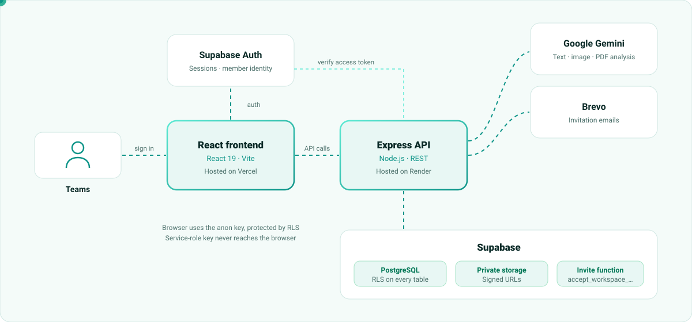

<div align="center">


<br>

[](https://unwind-brand-guard.vercel.app/)
[](https://react.dev/)
[](https://expressjs.com/)
[](https://supabase.com/)
[](https://aistudio.google.com/)

**[Live demo](https://unwind-brand-guard.vercel.app/)** &nbsp;|&nbsp; **[Features](#-features)** &nbsp;|&nbsp; **[How it works](#-how-it-works)** &nbsp;|&nbsp; **[Architecture](#-architecture)** &nbsp;|&nbsp; **[Getting started](#-getting-started)** &nbsp;|&nbsp; **[Roadmap](#-roadmap)**

</div>

<div align="center">

<sub>**AI advises. People decide.** &nbsp;·&nbsp; Text, image and PDF review &nbsp;·&nbsp; Explainable findings &nbsp;·&nbsp; Workspace-level security</sub>

</div>


## 📖 Table of contents

- [Why BrandGuard?](#-why-brandguard)
- [Features](#-features)
- [How it works](#-how-it-works)
- [Review workflow](#-review-workflow)
- [Compliance analytics](#-compliance-analytics)
- [Tech stack](#-tech-stack)
- [Architecture](#-architecture)
- [Project structure](#-project-structure)
- [Getting started](#-getting-started)
- [Environment variables](#-environment-variables)
- [Database and security](#-database-and-security)
- [Deployment configuration](#-deployment-configuration-for-new-installations)
- [Uptime monitoring](#-uptime-monitoring)
- [Troubleshooting](#-troubleshooting)
- [Round 2 to Round 3](#-round-2-to-round-3)
- [Testing and quality assurance](#-testing-and-quality-assurance)
- [What's shipped](#-whats-shipped)
- [Roadmap](#-roadmap)
- [Contributing](#-contributing)
- [License](#-license)


## 💡 Why BrandGuard?

Brand consistency breaks down quietly. Different teams, channels, and writers interpret the same guidelines differently, and PDF style guides are rarely open at the moment content is written.

**Unwind BrandGuard turns your brand guidelines into something that actively checks content.** Teams define their rules once, submit content for analysis, and get clear, explainable feedback: what is wrong, which guideline it breaks, and how to fix it. AI does the first pass. **People make the final call.**

| The problem | How BrandGuard helps |
|---|---|
| Guidelines live in static documents nobody checks | Guidelines become the live basis for AI evaluation |
| Reviews are slow and subjective | Instant, consistent first-pass analysis |
| Feedback says *what* but not *why* | Every finding links to the guideline it relates to |
| Review history gets lost in chat threads | Persistent review records and version history per workspace |
| Visual content slips through text-only checks | Images and PDFs are reviewed against the same guidelines |
| Onboarding reviewers is messy | Email invitations with role-based access |

<br>

<div align="center">

<sub>Illustration of a review. Every finding carries its evidence, the guideline it relates to, a severity, and a suggested fix.</sub>
</div>


## ✨ Features

<div align="center">

</div>

<br>

### 🔐 Authentication and workspaces
- Secure sign-up and login with **Supabase Auth**, with protected workspace access
- Create, rename, and manage workspaces with custom names
- Data is isolated per workspace and membership is checked on every request
- Role-based access control, with owner-level permissions protected

### 📚 Brand guidelines management
- Create and maintain workspace-specific brand guidelines
- Define rules for identity, tone of voice, messaging, terminology, and communication standards
- Guidelines act as the source of truth for every AI analysis

### 🤖 AI-powered content analysis
Powered by the **Google Gemini API**, each analysis checks content against your workspace's guidelines for:

- **Brand voice and tone**
- **Terminology consistency**
- **Unsupported promotional claims**
- **Approved-fact verification**
- **Accessibility concerns**

Each finding comes with a plain-language explanation, the guideline it relates to, and an actionable correction.

### 🖼️ Multimodal content review
Review more than text. BrandGuard analyzes visual and document-based content against the same approved guidelines.

- **Image analysis:** PNG, JPG, JPEG, and WEBP uploads, to catch visual brand inconsistencies, terminology issues, and accessibility concerns
- **PDF analysis:** submit PDF documents for content and visual compliance checks
- **Combined analysis:** submit text together with an image or PDF for one comprehensive review
- **Evidence-based findings:** every issue shows supporting evidence, a guideline reference, a severity level, and a recommended correction
- **Secure asset handling:** authenticated uploads, workspace-based access controls, private Supabase Storage, and signed URLs for viewing assets
- **Unified workflow:** multimodal results land in the same review history for human evaluation and approval

### ✅ Content review and approval
- Complete content submission workflow with review status management
- Reviewer and manager involvement, with approve, reject, and request-changes actions
- Collaborative review with **content version history**
- Human-controlled approvals: AI advises, people decide

### 📊 Compliance analytics
- Dashboard of brand governance insights and review results
- Compliance performance tracking over time
- Visibility into recurring guideline violations

### 👥 Team collaboration
- Invite members by email, delivered through **Brevo**
- Secure invitation flow: hashed tokens, automatic acceptance after authentication, and profile-name collection when needed
- Invited users land directly in the workspace they were invited to
- Members show real names (from Supabase Auth metadata) with email, joining date, and initials avatars

### 🔒 Security by design
- **PostgreSQL** via Supabase with **Row Level Security (RLS)**
- Privileged operations run only on the backend with admin credentials
- Rate limiting and content-length validation on analysis requests
- Secrets live in environment variables, never in frontend code


## 🔄 How it works

<div align="center">

</div>

1. **Sign in** through the React frontend. Supabase Auth manages sessions.
2. **Create a workspace** and define its brand guidelines.
3. **Submit content** as text, an image, a PDF, or a combination. The request goes through the Express backend.
4. The backend sends the content and the workspace's guidelines to **Google Gemini**.
5. **Findings come back** with violations, evidence, severity, linked guidelines, and suggested fixes.
6. **Review data is stored** in Supabase PostgreSQL, and uploaded assets in private Supabase Storage.
7. **Teammates review** and approve, reject, or request changes. Every revision is kept in version history.
8. **RLS policies** enforce workspace-level data access throughout.


## 🧭 Review workflow

<div align="center">

</div>

AI findings never publish anything on their own. Content moves forward only when a person approves it, and a requested change creates a new version so the full history stays traceable.


## 📊 Compliance analytics

<div align="center">

<sub>Illustration with sample numbers. The dashboard highlights score trends and which guidelines are broken most often.</sub>
</div>


## 🧰 Tech stack

<div align="center">

</div>

<br>

| Layer | Technology |
|---|---|
| **Frontend** | React 19, Vite, JavaScript, CSS |
| **Backend** | Node.js, Express.js (REST API) |
| **Database** | Supabase PostgreSQL with Row Level Security |
| **Storage** | Private Supabase Storage with signed URLs |
| **Auth** | Supabase Auth |
| **AI** | Google Gemini API (text, image, and PDF analysis) |
| **Email** | Brevo (transactional invitations) |
| **Hosting** | Vercel (frontend), Render (backend) |
| **Monitoring** | UptimeRobot |
| **Tooling** | Git and GitHub |


## 🏗️ Architecture

<div align="center">

</div>

For a deeper walkthrough, see [`PROJECT_ARCHITECTURE.md`](PROJECT_ARCHITECTURE.md).


## 📁 Project structure

```text
Unwind-BrandGuard/
├── frontend/                       # React 19 + Vite app
│   ├── src/
│   │   ├── components/             # Shared UI, landing demo, feedback/toasts, guided tour
│   │   ├── pages/                  # Overview, Guidelines, Content Reviews, Insights,
│   │   │                           # Team Members, Settings, Auth, Landing, legal pages
│   │   ├── services/               # API client helpers
│   │   ├── utils/
│   │   ├── supabase.js             # Supabase client (publishable key)
│   │   └── App.jsx
│   ├── vercel.json                 # SPA rewrites
│   └── package.json
│
├── backend/                        # Express REST API
│   ├── src/
│   │   ├── config/supabaseAdmin.js # Privileged Supabase client (secret key)
│   │   ├── controllers/            # analysis, invitations, workspaces
│   │   ├── middleware/             # authMiddleware, uploadMiddleware
│   │   ├── routes/                 # analysis, invitations, workspaces
│   │   ├── services/               # geminiService, emailService
│   │   └── server.js               # Entry point (/api/health)
│   └── package.json
│
├── supabase/
│   ├── schema.sql                  # Base schema, helper functions, RLS policies
│   └── migrations/                 # Run in filename order
├── docs/                           # README illustrations (SVG)
├── PROJECT_ARCHITECTURE.md
├── LICENSE.md
└── README.md
```


## ⚙️ Getting started

### Prerequisites

| Requirement | Notes |
|---|---|
| [Node.js](https://nodejs.org/) | Current LTS recommended |
| npm | Ships with Node.js |
| [Git](https://git-scm.com/) | |
| [Supabase](https://supabase.com/) project | Provides Auth, PostgreSQL, and Storage |
| [Google Gemini API key](https://aistudio.google.com/) | For content analysis |
| [Brevo](https://www.brevo.com/) account and API key | For invitation emails |

### 1. Clone the repository

```bash
git clone https://github.com/Unwind-BrandGuard/Unwind-BrandGuard.git
cd Unwind-BrandGuard
```

### 2. Set up the backend

```bash
cd backend
npm install
cp .env.example .env   # fill in every value, see Environment variables
npm run dev            # nodemon; use `npm start` for a plain run
```

The API listens on `PORT` (default `5000`). Confirm it is up at `http://localhost:5000/api/health`.

### 3. Set up the frontend

In a second terminal:

```bash
cd frontend
npm install
cp .env.example .env   # fill in every value
npm run dev
```

Vite prints the local URL (typically `http://localhost:5173`, which is also the backend's default allowed CORS origin).

### 4. Prepare the database

Run these in the Supabase **SQL Editor** (or with the Supabase CLI), **in this order**:

| Order | File | What it sets up |
|---|---|---|
| 1 | [`supabase/schema.sql`](supabase/schema.sql) | Workspaces, members, brand guidelines, helper functions (`is_workspace_member`, `has_workspace_role`), owner auto-assignment, RLS policies |
| 2 | [`supabase/migrations/20261113_workspace_invitations.sql`](supabase/migrations/20261113_workspace_invitations.sql) | `workspace_invitations` table, indexes, RLS, `accept_workspace_invitation` function |
| 3 | [`supabase/migrations/20261113_workspace_member_permissions.sql`](supabase/migrations/20261113_workspace_member_permissions.sql) | Tightened membership policies: owners manage everyone, admins manage editors, reviewers and viewers |

### 5. Create the storage bucket

Uploaded images and PDFs are stored in a **private** bucket named exactly `review-assets` (the name is set in the backend's analysis controller).

1. In Supabase, open **Storage → New bucket**.
2. Name it `review-assets` and leave **Public bucket** switched **off**.
3. Files are saved under `<workspace_id>/<random-uuid>.<ext>` and viewed through signed URLs.

### 6. Configure Supabase Auth

Set the **Site URL** to `http://localhost:5173` and add it to the **Redirect URLs** for local development.

### 7. Verify the setup

- `GET /api/health` returns a healthy response.
- You can sign up, create a workspace, and add a guideline.
- Submitting text for analysis returns findings (needs a valid `GEMINI_API_KEY`).
- Uploading a PNG, JPG, WEBP, or PDF up to 10 MB succeeds and the file appears in the `review-assets` bucket.


## 🔑 Environment variables

Copy each `.env.example` to `.env` and fill it in. The names below are exactly what the code reads.

### Backend (`backend/.env`)

| Variable | Required | Description |
|---|---|---|
| `PORT` | No | Express port. Defaults to `5000`. |
| `FRONTEND_URL` | Yes in production | Allowed CORS origin. Defaults to `http://localhost:5173`. |
| `SUPABASE_URL` | Yes | Your Supabase project URL |
| `SUPABASE_ANON_KEY` | Yes | Supabase publishable (anon) key, used with the caller's session so RLS applies |
| `SUPABASE_SECRET_KEY` | Yes | Supabase secret key for privileged operations. **Server-side only.** |
| `GEMINI_API_KEY` | Yes | Google Gemini API key |
| `BREVO_API_KEY` | Yes | Brevo API key for invitation emails |
| `BREVO_SENDER_EMAIL` | Yes | Verified Brevo sender address |
| `BREVO_SENDER_NAME` | Yes | Display name on invitation emails |

### Frontend (`frontend/.env`)

Vite only exposes variables prefixed with `VITE_`.

| Variable | Description |
|---|---|
| `VITE_SUPABASE_URL` | Your Supabase project URL |
| `VITE_SUPABASE_PUBLISHABLE_KEY` | Supabase publishable key (safe for the browser, protected by RLS) |
| `VITE_API_URL` | Base URL of the backend API |

> 🚨 **Never** put `SUPABASE_SECRET_KEY` in the frontend, and never commit `.env` files. Both apps ship a `.env.example` with placeholders.


## 🔒 Database and security

BrandGuard uses **Supabase PostgreSQL** for storage and **Supabase Auth** for identity. Access is restricted at the database level with **Row Level Security (RLS)**.

<div align="center">

</div>

### Workspace invitation infrastructure

- `workspace_invitations` table
- Database indexes for efficient lookups
- RLS configuration
- Privileges restricted to the backend's secret-key client
- `accept_workspace_invitation` database function
- Hashed invitation tokens with server-side validation

### Security practices

- ✅ Privileged operations go through the backend's separate Supabase admin client
- ✅ RLS enforces workspace-level data isolation
- ✅ Workspace membership and role checks on protected API routes
- ✅ Uploaded assets live in private storage and are viewed through signed URLs
- ✅ Content analysis is rate limited to 5 requests per minute, text is capped at 20,000 characters, and uploads are limited to one PNG, JPG, WEBP, or PDF file of up to 10 MB
- ✅ Credentials are loaded from environment variables
- ❌ Secrets are never exposed in frontend code or committed to Git

Found a vulnerability? Please report it privately to the maintainers rather than opening a public issue.


## 🚀 Deployment configuration for new installations

The production deployment is already live. The steps below are the **required setup for anyone deploying their own instance**.

| Component | Platform |
|---|---|
| Frontend | [Vercel](https://vercel.com/) |
| Backend | [Render](https://render.com/) |
| Database, Auth and Storage | [Supabase](https://supabase.com/) |
| Source code | GitHub |

**🔗 Live application:** https://unwind-brand-guard.vercel.app/

### Required setup steps

1. Set all backend environment variables in Render, including `FRONTEND_URL` set to your frontend's production origin (it drives the CORS allow-list).
2. Set all `VITE_*` variables in Vercel, with `VITE_API_URL` pointing at the deployed backend.
3. Apply `supabase/schema.sql` and the migrations in order (see [Getting started](#-getting-started)).
4. Create the private `review-assets` storage bucket.
5. Configure the Supabase Auth Site URL and Redirect URLs for your production domain.
6. Confirm RLS is enabled on every table.
7. Point an uptime monitor at `/api/health`.


## 📡 Uptime monitoring

Production services are monitored with [UptimeRobot](https://uptimerobot.com/).

| Feature | Description |
|---|---|
| **Backend monitoring** | Tracks backend health through the `/api/health` endpoint |
| **Frontend monitoring** | Monitors the production frontend |
| **Automated health checks** | HTTP(S) checks every 5 minutes |
| **Email notifications** | Alerts when downtime is detected |
| **Recovery detection** | Detects when services become available again |

**Monitored services**

- Backend: https://unwind-brandguard.onrender.com/api/health
- Frontend: https://unwind-brand-guard.vercel.app/


## 🩺 Troubleshooting

| Symptom | Likely cause and fix |
|---|---|
| Frontend can't reach the API | Check `VITE_API_URL` and the backend's CORS allowed origins |
| First request is slow on the hosted backend | Some hosting tiers spin down idle services; wait a moment and retry |
| Auth redirects fail | Verify Site URL and Redirect URLs in Supabase Auth settings |
| Invitation emails don't arrive | Check `BREVO_API_KEY`, the verified sender, and spam folders |
| Analysis returns an error | Verify `GEMINI_API_KEY` and your API quota |
| Analysis is rejected | Content may exceed the length limit, or the rate limit was hit; shorten the content or retry shortly |
| Image or PDF won't open | Confirm the storage bucket exists and that you belong to the workspace; signed URLs expire, so reload the review |
| Data missing or "permission denied" | Review RLS policies and the user's workspace membership |


## 🎯 Round 2 to Round 3

Round 2 set three commitments. All three were delivered in Round 3.

| Round 2 commitment | Round 3 delivered |
|---|---|
| Multimodal AI analysis | Text, image, PDF, and combined content review, with evidence, severity, guideline references, and recommended fixes |
| Collaborative review | Reviewer and manager involvement, review comments, approve, reject, and request-changes decisions, and content version history |
| Compliance analytics | Compliance scores, recurring violations, trends, and historical insights |

**All three improvements were manually tested** against the checks in [Testing and quality assurance](#-testing-and-quality-assurance).

> **Collaboration scope.** Round 3 delivers collaborative review through review comments, approval decisions, and version history. **Inline comments anchored to specific text and threaded replies are a separate future upgrade** (see the [Roadmap](#-roadmap)) and were not part of the Round 3 commitment.


## 🧪 Testing and quality assurance

All three Round 3 improvements were tested manually end to end against the running application. Automated tests are not part of the repository yet.

### Functional testing

| Improvement | What was verified |
|---|---|
| Multimodal analysis | Text-only, image-only, PDF-only, and text-plus-file submissions each return findings with evidence, severity, a guideline reference, and a recommended fix |
| Collaborative review | A submitted review can be commented on, approved, rejected, or sent back with changes requested, and each revision appears in version history |
| Compliance analytics | Scores, recurring violations, and trends update as reviews are submitted and decided |

### Negative testing

| Scenario | Expected behavior |
|---|---|
| Empty submission | Rejected: text or a file is required |
| Text over 20,000 characters | Rejected with a length message |
| Unsupported file type (anything other than PNG, JPG, WEBP, PDF) | Rejected with a supported-types message |
| File over 10 MB, or more than one file | Rejected |
| More than 5 analysis requests in one minute | Rate limited with a retry message |
| Request without a valid session | Rejected by the auth middleware |
| Accessing a workspace you do not belong to | Blocked by membership checks and RLS |
| Actions above your role (for example a viewer changing guidelines, or an admin altering an owner) | Blocked by role policies |
| Reusing, expiring, or tampering with an invitation token | Rejected by the invitation function |
| Repeating an action (double-click submit, re-accepting an invitation) | No duplicate records created |

### End-to-end flows

| Flow | Result |
|---|---|
| Sign up, log in, session restore, log out | Verified |
| Create workspace, add guidelines, invite a member by email, accept the invitation | Verified |
| Submit content, review findings, approve or reject, check analytics | Verified |
| Upload an image or PDF and view it afterwards through a signed URL | Verified |

### UI testing

| Area | Result |
|---|---|
| Light and dark mode, including the saved preference after a refresh | Verified |
| Page refresh keeps the user signed in on the same page | Verified |
| Navigation across Overview, Guidelines, Content Reviews, Insights, Team Members, and Settings | Verified |
| Error and loading states show readable messages | Verified |

### Results summary

| Test area | Outcome |
|---|---|
| Functional testing of all three improvements | ✅ Passed |
| Negative and security testing | ✅ Passed |
| End-to-end verification (auth, analysis, approvals, analytics) | ✅ Passed |
| UI testing (themes, persistence, navigation) | ✅ Passed |


## 📦 What's shipped

<details open>
<summary><b>Workspaces, teams and identity</b></summary>

- Custom workspace naming and rename
- Role-based team permissions with protected owner-level permissions
- Invitation flow: hashed tokens, automatic acceptance after authentication, profile-name collection, and correct workspace switching
- Member names from Supabase Auth metadata, with email, joining date, and initials avatars

</details>

<details open>
<summary><b>AI governance and multimodal review</b></summary>

- Guideline-based checks for voice and tone, terminology, promotional claims, approved facts, and accessibility
- Image and PDF review, plus combined text and file review
- Explanations and corrections that reference the applicable guidelines

</details>

<details open>
<summary><b>Review, approval and analytics</b></summary>

- Submission workflow with statuses, reviewer and manager involvement, approvals, rejections, and change requests
- Content version history
- Compliance analytics dashboard with recurring-violation visibility

</details>

<details open>
<summary><b>Security and infrastructure</b></summary>

- Protected workspace access, membership checks, and API request authentication
- Analysis rate limiting and content length validation
- Production deployment on Vercel, Render, and Supabase, with CORS configured and health verified
- Google Search Console ownership verified and sitemap submitted

</details>


## 🗺️ Roadmap

**Shipped:** AI text analysis, multimodal image and PDF review, guideline management, workspace collaboration, review workflows, version history, and compliance analytics.

**Next up:**

- [ ] **Deeper visual compliance.** Dedicated checks for logos, colour palettes, typography, and layout consistency.
- [ ] **Richer collaboration.** Inline comments anchored to specific text and threaded replies, building on the review comments that exist today.
- [ ] **Smarter analytics.** Trend forecasting, per-channel and per-author breakdowns, and exportable reports.
- [ ] **Guideline intelligence.** Suggest guideline improvements from recurring violations.

Have an idea? [Open an issue](https://github.com/Unwind-BrandGuard/Unwind-BrandGuard/issues) and tell us what would help your team.


## 🤝 Contributing

Contributions, suggestions, and feedback are welcome.

1. **Fork** the repository
2. **Create** a feature branch: `git checkout -b feature/your-feature`
3. **Commit** your changes: `git commit -m "Add your feature"`
4. **Test** the functionality
5. **Push** your branch: `git push origin feature/your-feature`
6. **Open a pull request** describing what you changed and why

## 📄 License

See [`LICENSE.md`](LICENSE.md) for license terms.

<br>

<div align="center">

**Built to make brand consistency smarter, simpler, and more accessible.**

🛡️ *Unwind BrandGuard: Define. Analyze. Protect.*

</div>
