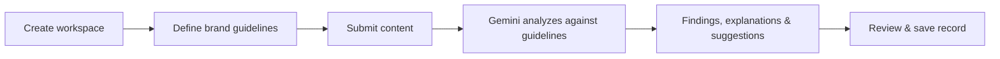
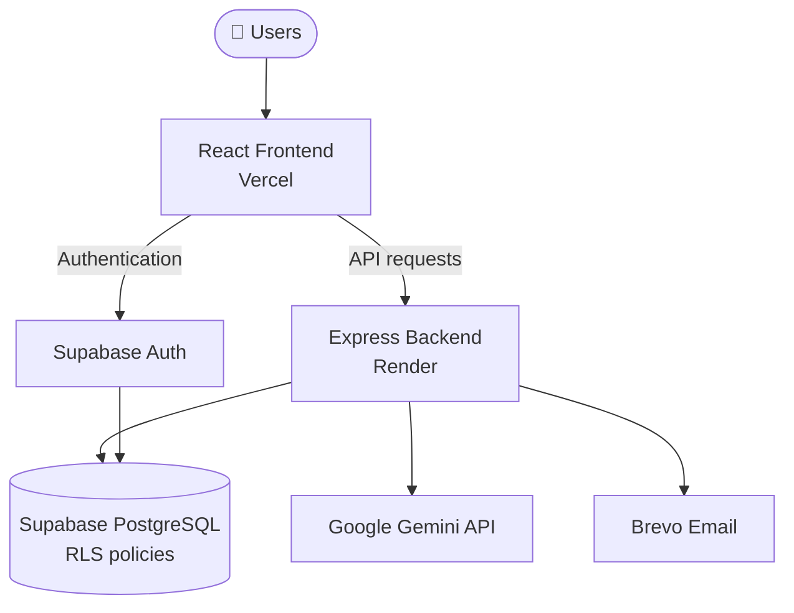

<div align="center">

# 🛡️ Unwind BrandGuard

### Define. Analyze. Protect.

**AI-powered brand governance and content compliance for teams that care about consistency.**

[**🚀 Live Demo**](https://unwind-brand-guard.vercel.app/) · [**✨ Features**](#-features) · [**🏗️ Architecture**](#️-architecture) · [**⚙️ Getting Started**](#️-getting-started) · [**🗺️ Roadmap**](#️-roadmap)

</div>

---

## 📖 Table of Contents

- [Why BrandGuard?](#-why-brandguard)
- [Features](#-features)
- [How It Works](#-how-it-works)
- [Tech Stack](#-tech-stack)
- [Architecture](#️-architecture)
- [Project Structure](#-project-structure)
- [Getting Started](#️-getting-started)
- [Environment Variables](#-environment-variables)
- [Database & Security](#-database--security)
- [Deployment](#-deployment)
- [Troubleshooting](#-troubleshooting)
- [Roadmap](#️-roadmap)
- [Contributing](#-contributing)
- [License](#-license)

---

## 💡 Why BrandGuard?

Brand consistency breaks down quietly. Different teams, channels, and writers interpret the same guidelines differently, and PDF style guides are rarely read at the moment content is written.

**Unwind BrandGuard turns your brand guidelines into something that actively checks content.** Teams define their rules once, submit content for analysis, and get clear, explainable feedback: what is wrong, which guideline it violates, and how to fix it.

| The problem | How BrandGuard helps |
|---|---|
| Guidelines live in static documents nobody checks | Guidelines become the live basis for AI evaluation |
| Reviews are slow and subjective | Instant, consistent first-pass analysis |
| Feedback says *what* but not *why* | Every finding is linked to the guideline it relates to |
| Review history gets lost in chat threads | Persistent review records per workspace |
| Onboarding reviewers is messy | Email invitations with role-based access |

---

## ✨ Features

### 🔐 Authentication & Workspaces
- Secure sign-up and login with **Supabase Auth**
- Create, rename, and manage workspaces
- Data is isolated per workspace
- Role-based access control

### 📚 Brand Guidelines Management
- Create and maintain workspace-specific brand guidelines
- Define rules for identity, tone of voice, messaging, and communication standards
- Guidelines act as the source of truth for every AI analysis

### 🤖 AI-Powered Content Analysis
- Analyze text against your workspace's guidelines using the **Google Gemini API**
- Detect potential brand compliance violations
- Get plain-language explanations for each issue
- See which guideline each finding relates to
- Receive actionable suggestions to improve the content

### ✅ Content Review Management
- Review AI-generated analysis results in one place
- Manage the review workflow
- Keep persistent review records for later reference

### 👥 Team Collaboration
- Invite members by email (delivered via **Brevo**)
- Secure invitation acceptance flow
- Manage workspace membership
- Permissions based on member role

### 🔒 Security by Design
- **PostgreSQL** via Supabase with **Row Level Security (RLS)**
- Privileged operations run only on the backend with admin credentials
- Secrets live in environment variables, never in frontend code

---

## 🔄 How It Works



1. **Sign in** through the React frontend (Supabase Auth manages sessions).
2. **Create a workspace** and configure its brand guidelines.
3. **Submit content** for analysis. The request goes through the Express backend.
4. The backend sends the content and relevant guidelines to **Google Gemini**.
5. **Findings and recommendations** are returned: violations, explanations, linked guidelines, and suggested fixes.
6. **Review data is stored** in Supabase PostgreSQL.
7. **Teammates are invited** by email through Brevo.
8. **RLS policies** enforce workspace-level data access throughout.

---

## 🧰 Tech Stack

| Layer | Technology |
|---|---|
| **Frontend** | React 19, Vite, JavaScript, CSS |
| **Backend** | Node.js, Express.js (REST API) |
| **Database** | Supabase PostgreSQL with Row Level Security |
| **Auth** | Supabase Auth |
| **AI** | Google Gemini API |
| **Email** | Brevo (transactional invitations) |
| **Hosting** | Vercel (frontend), Render (backend) |
| **Tooling** | Git & GitHub |

---

## 🏗️ Architecture



<details>
<summary><b>ASCII version</b></summary>

```text
                    ┌──────────────────────┐
                    │        Users         │
                    └──────────┬───────────┘
                               │
                    ┌──────────▼───────────┐
                    │    React Frontend    │
                    │       (Vercel)       │
                    └──────┬────────┬──────┘
                           │        │
                  Authentication    │ API Requests
                           │        │
                 ┌─────────▼──┐  ┌──▼──────────────┐
                 │ Supabase   │  │ Express Backend │
                 │ Auth       │  │    (Render)     │
                 └────────────┘  └──────┬──────┬───┘
                                        │      │
                              ┌─────────▼─┐  ┌─▼─────────┐
                              │  Gemini   │  │   Brevo   │
                              │    API    │  │   Email   │
                              └───────────┘  └───────────┘
                                        │
                              ┌─────────▼──────────┐
                              │ Supabase PostgreSQL│
                              │ Persistent Storage │
                              │ RLS Policies       │
                              └────────────────────┘
```

</details>

---

## 📁 Project Structure

```text
Unwind-BrandGuard/
├── frontend/
│   ├── src/
│   │   ├── components/        # Reusable UI components
│   │   ├── pages/             # Route-level pages
│   │   ├── supabase.js        # Supabase client setup
│   │   ├── App.jsx
│   │   └── App.css
│   ├── public/
│   └── package.json
│
├── backend/
│   ├── src/
│   │   ├── config/
│   │   │   └── supabaseAdmin.js   # Privileged Supabase client
│   │   ├── routes/                # API route definitions
│   │   ├── controllers/           # Request handlers
│   │   ├── middleware/            # Auth, validation, etc.
│   │   └── server.js              # Entry point
│   └── package.json
│
├── .gitignore
└── README.md
```

> This is a representative structure; the repository may contain additional files.

---

## ⚙️ Getting Started

### Prerequisites

| Requirement | Notes |
|---|---|
| [Node.js](https://nodejs.org/) | Current LTS recommended |
| npm | Ships with Node.js |
| [Git](https://git-scm.com/) | |
| [Supabase](https://supabase.com/) project | Provides Auth and PostgreSQL |
| [Google Gemini API key](https://aistudio.google.com/) | For content analysis |
| [Brevo](https://www.brevo.com/) account + API key | For invitation emails |

### 1. Clone the repository

```bash
git clone <YOUR_GITHUB_REPOSITORY_URL>
cd Unwind-BrandGuard
```

### 2. Set up the backend

```bash
cd backend
npm install
cp .env.example .env   # then fill in your values (see Environment Variables)
npm run dev
```

The API starts on the port set by `PORT` (default `5000`).

### 3. Set up the frontend

In a second terminal:

```bash
cd frontend
npm install
cp .env.example .env   # then fill in your values
npm run dev
```

Vite will print the local URL (typically `http://localhost:5173`).

### 4. Prepare the database

Apply your Supabase schema, RLS policies, and the invitation function described in [Database & Security](#-database--security) before testing workspaces and invitations.

---

## 🔑 Environment Variables

> ⚠️ Always use the **exact variable names** your source code reads. The tables below show the typical setup.

### Backend (`backend/.env`)

| Variable | Description |
|---|---|
| `PORT` | Port for the Express server (e.g. `5000`) |
| `SUPABASE_URL` | Your Supabase project URL |
| `SUPABASE_SERVICE_ROLE_KEY` | Supabase service-role key. **Server-side only.** |
| `GEMINI_API_KEY` | Google Gemini API key |
| `BREVO_API_KEY` | Brevo API key for invitation emails |

### Frontend (`frontend/.env`)

Vite only exposes variables prefixed with `VITE_`. Match the names used in `src/supabase.js`, for example:

| Variable | Description |
|---|---|
| `VITE_SUPABASE_URL` | Your Supabase project URL |
| `VITE_SUPABASE_ANON_KEY` | Supabase public anon key (safe for the browser, protected by RLS) |
| `VITE_API_URL` | Base URL of the backend API |

> 🚨 **Never** put the service-role key in the frontend, and never commit `.env` files. Add a `.env.example` with placeholder values so contributors know what to configure.

---

## 🔒 Database & Security

BrandGuard uses **Supabase PostgreSQL** for storage and **Supabase Auth** for identity. Access is restricted at the database level with **Row Level Security (RLS)**.

### Workspace invitation infrastructure

- `workspace_invitations` table
- Database indexes for efficient lookups
- RLS configuration
- Service-role-specific privileges
- `accept_workspace_invitation` database function

### Security practices

- ✅ Privileged operations go through the backend's separate Supabase admin client
- ✅ RLS enforces workspace-level data isolation
- ✅ Credentials are loaded from environment variables
- ✅ Role-based permissions govern workspace operations
- ❌ Secrets are never exposed in frontend code or committed to Git

Found a vulnerability? Please report it privately to the maintainers rather than opening a public issue.

---

## 🚀 Deployment

| Component | Platform |
|---|---|
| Frontend | [Vercel](https://vercel.com/) |
| Backend | [Render](https://render.com/) |
| Database & Auth | [Supabase](https://supabase.com/) |
| Source code | GitHub |

**🔗 Live application:** https://unwind-brand-guard.vercel.app/

### Deployment checklist

- [ ] Set all backend environment variables in Render
- [ ] Set all `VITE_*` variables in Vercel
- [ ] Point `VITE_API_URL` at the deployed backend
- [ ] Allow the frontend's production origin in the backend's CORS configuration
- [ ] Configure the Supabase Auth site URL and redirect URLs for your production domain
- [ ] Confirm RLS policies are enabled on all tables

---

## 📡 Uptime Monitoring

Unwind BrandGuard uses [UptimeRobot](https://uptimerobot.com/) to monitor the availability of its production services.

| Monitoring Feature | Description |
|---|---|
| **Backend Monitoring** | Tracks backend health through the `/api/health` endpoint |
| **Frontend Monitoring** | Monitors the production frontend |
| **Automated Health Checks** | HTTP(S) checks every 5 minutes |
| **Email Notifications** | Alerts when service downtime is detected |
| **Recovery Detection** | Detects when services become available again |

**Monitored Services:**

- Backend: https://unwind-brandguard.onrender.com/api/health
- Frontend: https://unwind-brand-guard.vercel.app/

This monitoring setup helps identify service interruptions and track production availability.

---

## 🩺 Troubleshooting

| Symptom | Likely cause and fix |
|---|---|
| Frontend can't reach the API | Check `VITE_API_URL` and the backend's CORS allowed origins |
| First request is slow on the hosted backend | Some hosting tiers spin down idle services; wait a moment and retry |
| Auth redirects fail | Verify Site URL and Redirect URLs in Supabase Auth settings |
| Invitation emails don't arrive | Check `BREVO_API_KEY`, the verified sender, and spam folders |
| Analysis returns an error | Verify `GEMINI_API_KEY` and your API quota |
| Data missing or "permission denied" | Review RLS policies and the user's workspace membership |

---

## 🗺️ Roadmap

**Current focus:** AI text analysis, guideline management, workspace collaboration, and review workflows.

- [ ] **Multimodal brand compliance.** Analyze images and documents, including logos, colours, typography, and layout consistency.
- [ ] **Collaborative reviews and version history.** Comments, reviewer feedback, revision tracking, and detailed approval history.
- [ ] **Compliance intelligence and analytics.** Surface recurring violations, track compliance trends, and generate actionable insights.

Have an idea? [Open an issue](../../issues) and tell us what would help your team.

---

## 🤝 Contributing

Contributions, suggestions, and feedback are welcome.

1. **Fork** the repository
2. **Create** a feature branch: `git checkout -b feature/your-feature`
3. **Commit** your changes: `git commit -m "Add your feature"`
4. **Test** the functionality
5. **Push** your branch: `git push origin feature/your-feature`
6. **Open a pull request** describing what you changed and why

---

## 📄 License

No open-source license has been specified. **All rights are reserved by the project owners** unless a license is added to this repository.

---

<div align="center">

**Built to make brand consistency smarter, simpler, and more accessible.**

🛡️ *Unwind BrandGuard — Define. Analyze. Protect.*

</div>
